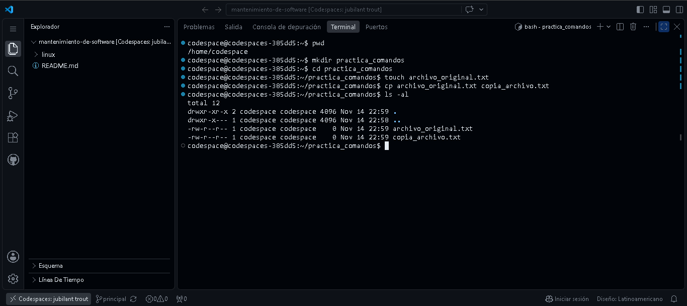
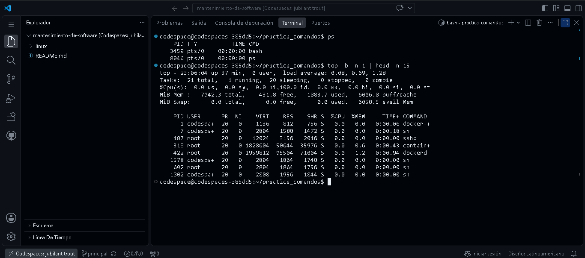
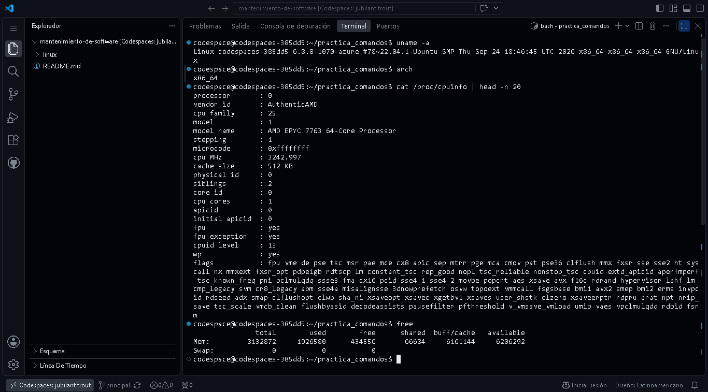
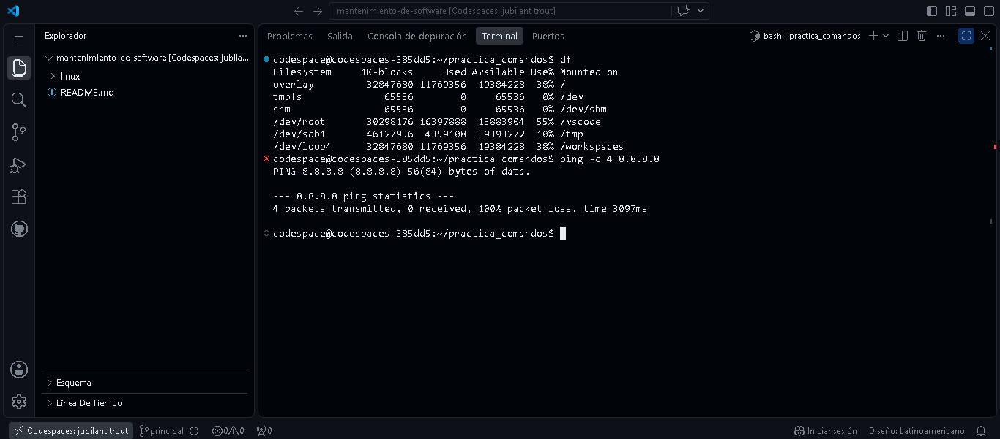

# TP: Comandos Básicos, Procesos y Utilidades en Linux

* **Materia:** Mantenimiento de Software
* **Estudiante:** Samuel Francisco Guaimas
* **Curso:** 4.º 3.ª – Técnico Informático – E.E.T. N.º 3139
* **Fecha de Entrega:** Noviembre 2026
* **Profesor:** Artaza

> **Entorno utilizado:** las prácticas se realizaron en una terminal Linux (Ubuntu 22.04) de **GitHub Codespaces**, con el usuario `codespace` en el equipo `codespaces-385dd5`.

---

## 1. Gestión de Archivos y Directorios

**Comandos ejecutados:**

```bash
pwd
mkdir practica_comandos
cd practica_comandos
touch archivo_original.txt
cp archivo_original.txt copia_archivo.txt
ls -al
```



En la captura se ve que `pwd` muestra el directorio actual (`/home/codespace`). Después se crea la carpeta `practica_comandos` con `mkdir`, se entra en ella con `cd` (el prompt cambia a `~/practica_comandos`), se crea un archivo vacío con `touch` y se hace una copia con `cp`.

* **Explicación de `ls -al`:** El comando `ls` simple muestra solamente los **nombres** de los archivos y carpetas visibles. En cambio, `ls -al` combina dos opciones:
  * `-a` (*all*): muestra **todos** los archivos, incluidos los ocultos (los que empiezan con punto). Por eso en la captura aparecen `.` (el directorio actual) y `..` (el directorio padre).
  * `-l` (*long*): muestra el **formato largo**, con información detallada de cada archivo: permisos (`-rw-r--r--`), cantidad de enlaces, usuario dueño y grupo (`codespace`), tamaño en bytes (`0`, porque los archivos están vacíos), fecha y hora de modificación y el nombre.

---

## 2. Monitoreo de Procesos

**Comandos ejecutados:**

```bash
ps
top
```

Para que la captura muestre en la misma pantalla el prompt, la salida de `ps` y la de `top`, se usó además `top -b -n 1 | head -n 15`. La opción `-b` (*batch*) hace que `top` imprima su información como texto en la terminal, `-n 1` indica que lo haga una sola vez y `head -n 15` muestra solo las primeras 15 líneas. Antes de eso, `top` se ejecutó de forma interactiva y se salió con la tecla `q`.



* **Diferencia entre `ps` y `top`:** `ps` sin opciones muestra una **foto fija** de los procesos de la **terminal actual** en el momento en que se ejecuta. En la captura solo aparecen dos: `bash` (la terminal) y el propio `ps`, cada uno con su PID. En cambio, `top` es una herramienta **interactiva** que muestra **todos los procesos del sistema en tiempo real**, actualizándose cada pocos segundos. Además, en la parte de arriba muestra un resumen del sistema: tiempo encendido (`up 37 min`), cantidad de tareas (21 en total, 1 ejecutándose y 20 en espera), uso de CPU y uso de memoria. También permite ordenar los procesos según cuánto consumen.

* **Uso de `kill`:** El comando `kill PID` sirve para **terminar un proceso** usando su número de identificación (PID), que se puede averiguar con `ps` o `top`. Se usa cuando un programa se cuelga o deja de responder: por ejemplo, `kill 3459` terminaría el proceso con PID 3459. Por defecto, `kill` le envía una señal para que el programa se cierre de forma ordenada. Si el programa no responde, se puede forzar el cierre con `kill -9 PID`.

---

## 3. Información del Sistema

**Comandos ejecutados:**

```bash
uname -a
arch
cat /proc/cpuinfo
free
```

En la captura se usó `cat /proc/cpuinfo | head -n 20` para mostrar solo las primeras 20 líneas, ya que la salida completa es muy larga y no entraba en una sola pantalla junto con los demás comandos.



* **Detalles del Kernel y Memoria:**
  * **`uname -a`** muestra toda la información sobre el **núcleo (kernel)** del sistema operativo. En la captura se ve:
    * `Linux`: el nombre del núcleo.
    * `codespaces-385dd5`: el nombre del equipo (host).
    * `6.8.0-1070-azure`: la **versión del kernel**. El agregado *azure* indica que está adaptado para los servidores de Microsoft Azure, donde corre Codespaces.
    * `#78~22.04.1-Ubuntu SMP ...`: la compilación del kernel y la distribución (Ubuntu 22.04). *SMP* significa que soporta varios procesadores.
    * `x86_64`: la **arquitectura** del procesador (64 bits), que coincide con lo que muestra el comando `arch`.
    * `GNU/Linux`: el sistema operativo.
  * **`cat /proc/cpuinfo`** muestra los datos del procesador. En este caso es un **AMD EPYC 7763** a unos 3242 MHz, con 512 KB de memoria caché.
  * **`free`** muestra el **uso de la memoria RAM y de la memoria de intercambio (swap)**, expresado en kilobytes:
    * `total`: memoria total, unos 8 GB (8132872 KB).
    * `used`: memoria en uso, unos 1,9 GB.
    * `free`: memoria completamente libre, unos 434 MB.
    * `buff/cache`: memoria que Linux usa como caché para acelerar el sistema y que libera si un programa la necesita.
    * `available`: memoria realmente disponible para nuevos programas, unos 6 GB.
    * `Swap: 0`: este equipo no tiene memoria de intercambio configurada.

---

## 4. Red y Espacio en Disco

**Comandos ejecutados:**

```bash
df
ping -c 4 8.8.8.8
```

> **Nota:** el Codespaces no traía instalado el programa `ping` (daba el error `ping: command not found`), así que antes se instaló con `sudo apt-get update && sudo apt-get install -y iputils-ping`.



* **`df`** muestra el **espacio en disco** de cada sistema de archivos montado: el tamaño total (en bloques de 1 KB), lo usado, lo disponible, el porcentaje de uso y dónde está montado. Por ejemplo, el sistema de archivos principal (`/`) tiene unos 32 GB y está usado al 38%.

* **Funcionamiento de `ping`:** El objetivo principal de `ping` es **comprobar si hay conectividad** entre nuestro equipo y otro equipo de una red TCP/IP. Envía paquetes del protocolo **ICMP** (*echo request*) a una dirección IP y espera que el otro equipo responda (*echo reply*). Así se puede saber si el destino está accesible, cuánto tarda en responder (latencia, en milisegundos) y si se pierden paquetes en el camino. La opción `-c 4` indica que se envíen solo 4 paquetes. La dirección `8.8.8.8` es el servidor DNS público de Google, que se suele usar para probar si hay salida a Internet.

* **Análisis del resultado obtenido:** En la captura se enviaron 4 paquetes y se recibieron 0 (**100% packet loss**). Esto **no significa que no haya Internet**: el equipo sí tiene conexión, ya que pudo descargar e instalar `ping` desde los servidores de Ubuntu. Lo que ocurre es que los Codespaces funcionan en servidores de Microsoft Azure, cuya red **bloquea los paquetes ICMP** que salen hacia Internet. Esto muestra algo importante para el diagnóstico de redes: que un `ping` falle indica que no hubo respuesta, pero la causa puede ser un firewall que bloquea ICMP y no necesariamente una falta de conexión.
