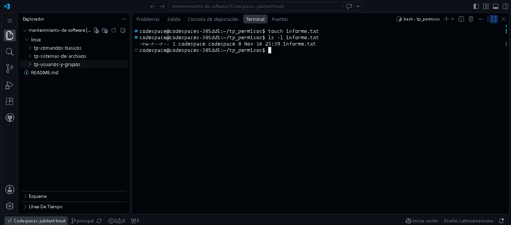
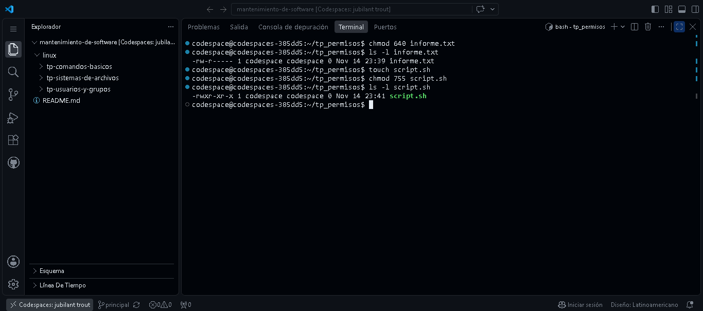
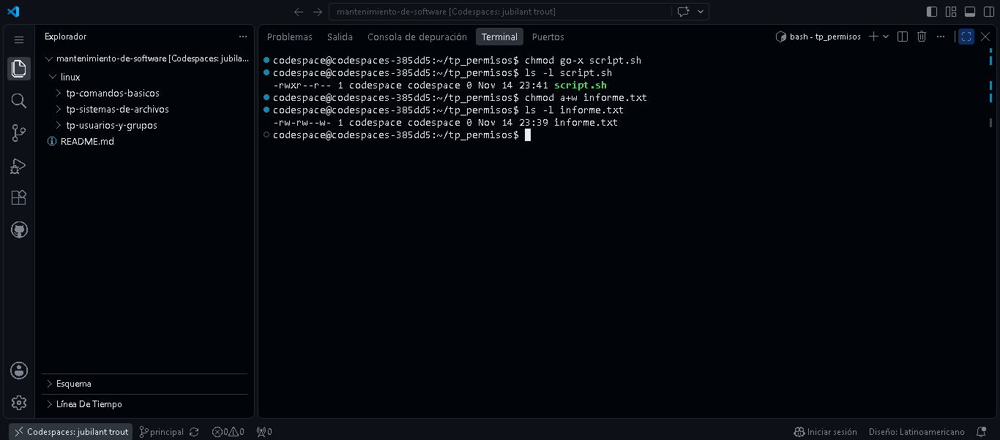
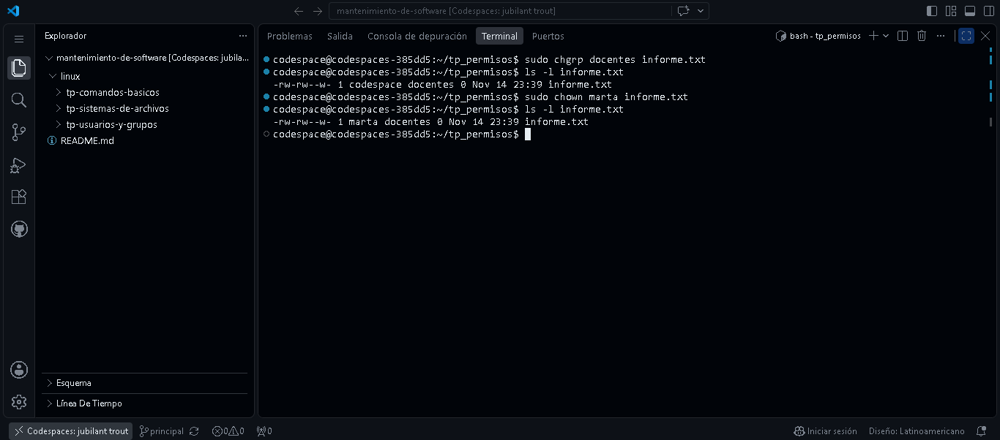
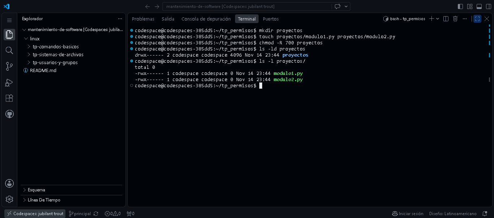

# TP: Permisos de Archivos, Directorios y Propiedad en Linux

* **Materia:** Mantenimiento de Software
* **Estudiante:** Samuel Francisco Guaimas
* **Curso:** 4.º 3.ª – Técnico Informático – E.E.T. N.º 3139
* **Fecha de Entrega:** Noviembre 2026
* **Profesor:** Artaza

> **Entorno utilizado:** las prácticas se realizaron en una terminal Linux (Ubuntu 22.04) de **GitHub Codespaces**, con el usuario `codespace` en el equipo `codespaces-385dd5`, dentro del directorio de trabajo `~/tp_permisos`.

---

## 1. Lectura e Interpretación de Permisos (`ls -l`)

**Comandos ejecutados:**

```bash
touch informe.txt
ls -l informe.txt
```



En la captura, el archivo recién creado aparece así:

```
-rw-r--r-- 1 codespace codespace 0 Nov 14 23:39 informe.txt
```

La columna de permisos `-rw-r--r--` tiene **10 caracteres**: el primero indica el **tipo** de elemento y los 9 restantes se dividen en **3 grupos de 3**, uno para cada nivel de usuario.

| Posición | Representación | Significado / Permiso |
| :--- | :--- | :--- |
| Tipo (1.er carácter) | `-` / `d` / `l` | `-` = archivo común, `d` = directorio (*directory*), `l` = enlace simbólico (*link*), un acceso directo a otro archivo. En la captura es `-` porque `informe.txt` es un archivo común. |
| Propietario (`u`) – caracteres 2 a 4 | `rw-` | Permisos del **dueño** del archivo (`codespace`): puede **leer** (`r`) y **escribir** (`w`), pero **no ejecutar** (`-`). |
| Grupo (`g`) – caracteres 5 a 7 | `r--` | Permisos de los usuarios que pertenecen al **grupo** del archivo (`codespace`): solo pueden **leer**. |
| Otros (`o`) – caracteres 8 a 10 | `r--` | Permisos del **resto de los usuarios** del sistema: solo pueden **leer**. |

**Significado de cada letra:**

* `r` (*read*, lectura): en un archivo, permite ver su contenido. En un directorio, permite listar lo que contiene.
* `w` (*write*, escritura): en un archivo, permite modificarlo. En un directorio, permite crear, borrar o renombrar archivos dentro.
* `x` (*execute*, ejecución): en un archivo, permite ejecutarlo como programa o script. En un directorio, permite entrar en él.
* `-`: el permiso de esa posición **no está concedido**.

---

## 2. Permisos en Modo Octal

**Comandos ejecutados:**

```bash
chmod 640 informe.txt
ls -l informe.txt
touch script.sh
chmod 755 script.sh
ls -l script.sh
```



En la captura se ve que `informe.txt` pasa a tener `-rw-r-----` y `script.sh` queda con `-rwxr-xr-x`. Además, `script.sh` aparece en **verde**, porque la terminal resalta los archivos que tienen permiso de ejecución.

En el modo octal, cada permiso tiene un valor: **r = 4**, **w = 2**, **x = 1** y **- = 0**. Se suman los valores de cada grupo de tres para obtener un dígito por nivel (propietario, grupo, otros).

* **Desglose numérico `640`:**

  | Nivel | Permisos | Cálculo | Dígito |
  | :--- | :--- | :--- | :---: |
  | Propietario | `rw-` | 4 + 2 + 0 | **6** |
  | Grupo | `r--` | 4 + 0 + 0 | **4** |
  | Otros | `---` | 0 + 0 + 0 | **0** |

  Resultado: `rw-r-----` = **640**

* **Desglose numérico `755`:**

  | Nivel | Permisos | Cálculo | Dígito |
  | :--- | :--- | :--- | :---: |
  | Propietario | `rwx` | 4 + 2 + 1 | **7** |
  | Grupo | `r-x` | 4 + 0 + 1 | **5** |
  | Otros | `r-x` | 4 + 0 + 1 | **5** |

  Resultado: `rwxr-xr-x` = **755**

---

## 3. Modo Simbólico

**Comandos ejecutados:**

```bash
chmod go-x script.sh
ls -l script.sh
chmod a+w informe.txt
ls -l informe.txt
```



En la captura se ve el resultado de cada comando:

* `chmod go-x script.sh`: quita (`-`) la ejecución (`x`) al grupo (`g`) y a otros (`o`). Pasa de `rwxr-xr-x` (755) a **`rwxr--r--`** (744). El propietario conserva su permiso de ejecución.
* `chmod a+w informe.txt`: agrega (`+`) la escritura (`w`) a todos (`a` = *all*). Pasa de `rw-r-----` (640) a **`rw-rw--w-`** (662). Los permisos de lectura que ya tenía no cambiaron.

Identificadores usados: `u` = propietario, `g` = grupo, `o` = otros, `a` = todos; `+` agrega, `-` quita y `=` asigna exactamente.

* **Ventaja del modo simbólico:** Permite **modificar un permiso puntual sin tocar los demás**. Con la notación octal hay que escribir siempre los **tres dígitos completos**, así que primero hay que saber qué permisos tiene el archivo y calcular el número nuevo. Si se calcula mal, se pueden cambiar sin querer permisos que no se querían modificar. En cambio, con `chmod go-x` solo se quita la ejecución a grupo y otros, sin importar qué otros permisos tenga el archivo. Además, es más fácil de leer y de recordar: `a+w` se entiende directamente como "agregar escritura a todos".

---

## 4. Cambio de Propietario y Grupo

**Preparación:** como el grupo `docentes` y la usuaria `marta` se habían eliminado al final del TP de usuarios y grupos, se volvieron a crear antes de esta consigna:

```bash
sudo groupadd docentes
sudo useradd -g docentes marta
```

**Comandos ejecutados:**

```bash
sudo chgrp docentes informe.txt
ls -l informe.txt
sudo chown marta informe.txt
ls -l informe.txt
```



En la captura se ve que primero cambia el **grupo** del archivo de `codespace` a **`docentes`**, y luego el **propietario** de `codespace` a **`marta`**:

```
-rw-rw--w- 1 marta docentes 0 Nov 14 23:39 informe.txt
```

**Consecuencia del cambio:** como ahora el usuario `codespace` no es el dueño ni pertenece al grupo `docentes`, le corresponden los permisos de **otros** (`-w-`). Es decir, ya **no puede leer** `informe.txt`, aunque fue él quien lo creó. Esto muestra que los permisos que se aplican dependen de quién es el propietario y de cuál es el grupo del archivo.

* **¿Por qué se requiere privilegio de superusuario para `chown`?** Porque cambiar el dueño de un archivo es una acción que afecta la **seguridad** del sistema. Si cualquier usuario pudiera hacerlo, podría:
  * **Regalar** archivos a otros usuarios para saltarse los límites de espacio en disco (cuotas) o hacer que parezca que otro usuario creó un archivo.
  * **Crear programas peligrosos** y pasarlos a nombre de `root` u otro usuario para hacerse pasar por él.

  Por eso Linux solo permite que el usuario **root** (o alguien con `sudo`) cambie el propietario de un archivo. Un usuario común solo puede cambiar el grupo de sus propios archivos, y únicamente a un grupo al que él mismo pertenezca.

---

## 5. Permisos Recursivos en Directorios

**Comandos ejecutados:**

```bash
mkdir proyectos
touch proyectos/modulo1.py proyectos/modulo2.py
chmod -R 700 proyectos
ls -ld proyectos
ls -l proyectos/
```



En la captura se ve que, gracias a la opción `-R` (*recursivo*), el permiso **700** (`rwx------`) se aplicó **tanto a la carpeta** `proyectos` (`drwx------`, donde la `d` indica que es un directorio) **como a los archivos de adentro** (`modulo1.py` y `modulo2.py` quedan con `-rwx------`). Ahora solo el propietario puede acceder; el grupo y otros no tienen ningún permiso. Se usó `ls -ld` para ver los permisos de la carpeta en sí (sin `-d`, `ls` mostraría su contenido).

* **Importancia del permiso `x` en un directorio:** En un directorio, el permiso de ejecución `x` **no significa ejecutarlo**: significa poder **entrar o atravesar** ese directorio. Permite hacer `cd` dentro de él y acceder a los archivos que contiene (abrirlos, leerlos o modificarlos, según los permisos de cada archivo).

  **Si a un directorio se le quita el permiso `x`:**
  * No se puede entrar con `cd` (da *Permission denied*).
  * No se puede abrir ni leer ningún archivo de adentro, **aunque el archivo tenga permisos de lectura**.
  * Si se mantiene la `r`, `ls` puede mostrar los **nombres** de los archivos, pero no sus detalles (permisos, tamaño, fecha). Aparecen con signos de pregunta (`?`).

  Por eso, en los directorios los permisos `r` y `x` normalmente se dan juntos.
