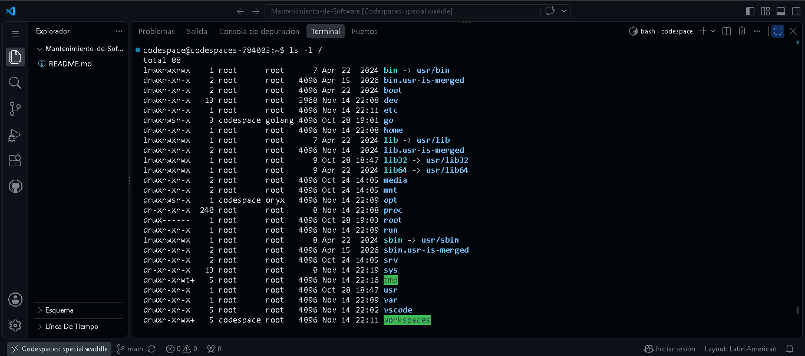
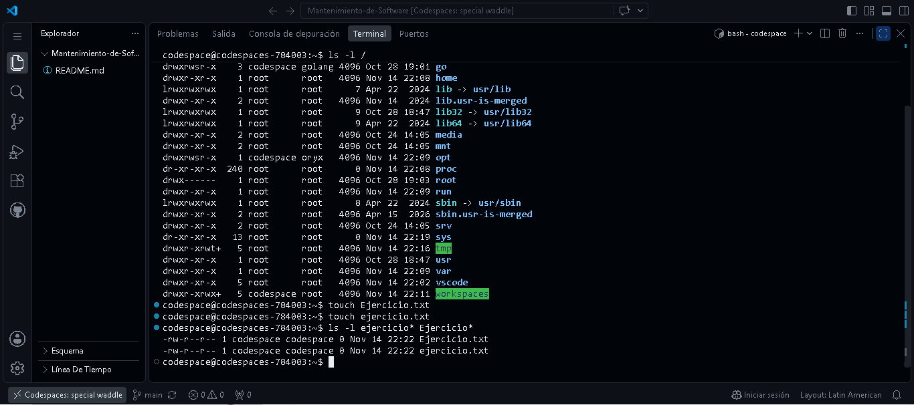
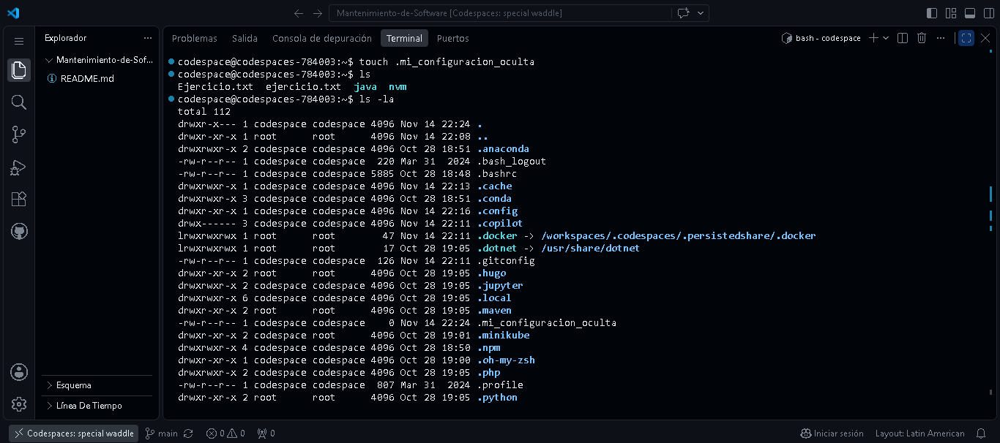
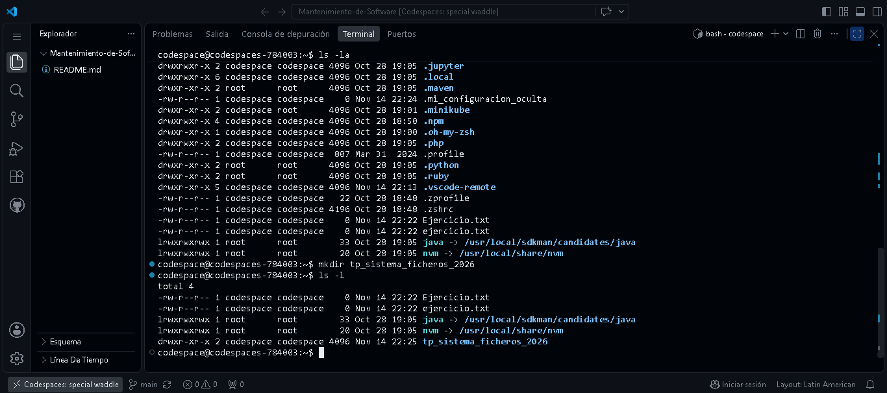
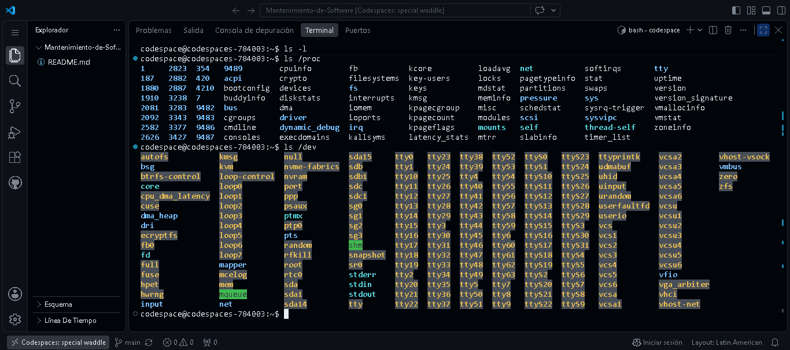

# TP: Sistema de Archivos en Linux

* **Materia:** Mantenimiento de Software
* **Estudiante:** Samuel Francisco Guaimas
* **Curso:** 4º 3º – Técnico Informático – E.E.T. N.º 3139
* **Fecha de Entrega:** Noviembre 2026
* **Profesor:** Artaza

> **Entorno utilizado:** las prácticas se realizaron en una terminal Linux (Ubuntu) de **GitHub Codespaces**, con el usuario `codespace` en el equipo `codespaces-784003`.

---

## 1. Estructura del Árbol de Directorios

**Comando ejecutado:**

```bash
ls -l /
```



En la captura se ve que todos los directorios del sistema (`bin`, `boot`, `dev`, `etc`, `home`, `proc`, `usr`, `var`, etc.) cuelgan de la raíz `/`, que es el punto de partida de todo el árbol de directorios de Linux.

| Directorio | Función según la guía |
| :--- | :--- |
| `/etc` | Archivos de configuración de la mayoría de los programas. |
| `/home` | Archivos personales de los usuarios. |
| `/dev` | Archivos simbólicos que representan hardware. |
| `/var` | Datos variables como registros (logs) y bases de datos. |

---

## 2. Sensibilidad a Mayúsculas y Minúsculas

**Comandos ejecutados:**

```bash
touch Ejercicio.txt
touch ejercicio.txt
ls -l ejercicio* Ejercicio*
```



*Respuesta:* En la captura se ve que el comando `ls -l` muestra **dos archivos distintos**, `Ejercicio.txt` y `ejercicio.txt`, en la misma carpeta. Esto pasa porque el sistema de archivos de Linux es **case sensitive**, es decir, distingue entre mayúsculas y minúsculas: para Linux la letra `E` y la letra `e` son caracteres diferentes, por lo tanto son dos nombres diferentes. En cambio, Windows (con su sistema de archivos NTFS, por defecto) no distingue mayúsculas de minúsculas y considera que ambos nombres son el mismo archivo, así que no permite tenerlos juntos en la misma carpeta.

---

## 3. Visualización y Gestión de Archivos Ocultos

**Comandos ejecutados:**

```bash
touch .mi_configuracion_oculta
ls
ls -la
```



*Respuesta:* En la captura se ve que el comando `ls` solo muestra `Ejercicio.txt`, `ejercicio.txt`, `java` y `nvm`, pero **no** muestra `.mi_configuracion_oculta`. En cambio, `ls -la` (la opción `-a` significa *all*, todos) sí lo muestra, junto con muchos otros archivos ocultos del sistema como `.bashrc`, `.profile` o `.config`.

Los archivos ocultos se usan principalmente para guardar **configuraciones** del sistema y de los programas de cada usuario. Por ejemplo, `.bashrc` guarda la configuración de la terminal. Se ocultan para:

* Mantener ordenada la carpeta personal y que no molesten en el uso diario.
* Evitar que el usuario los borre o modifique por error, ya que si se dañan algunos programas podrían dejar de funcionar correctamente.

---

## 4. Buenas Prácticas en Nombres de Archivos

**Comandos ejecutados:**

```bash
mkdir tp_sistema_ficheros_2026
ls -l
```



*Respuesta:* En la captura se ve que la carpeta `tp_sistema_ficheros_2026` se creó correctamente (aparece en el listado con una `d` al principio, que indica que es un directorio). Este nombre cumple con las recomendaciones porque:

* Usa solo letras minúsculas, números y guiones bajos (`_`).
* No tiene espacios (se reemplazan por `_`).
* No tiene acentos, ni la letra "ñ", ni caracteres especiales.

En cambio, `TP Sistema de Ficheros (Año 2026)!.doc` **no** cumple porque:

* Tiene **espacios**, lo que obliga a escribir el nombre entre comillas o con `\` en la terminal; si no, el sistema lo interpreta como varios archivos distintos.
* Tiene **caracteres especiales** como `(`, `)` y `!`, que la terminal (bash) usa con un significado propio y pueden provocar errores al ejecutar comandos.
* Tiene la letra **"ñ"** en "Año", que puede dar problemas de codificación al pasar el archivo a otros sistemas.
* Mezcla **mayúsculas y minúsculas**, lo que en Linux puede causar confusiones (como se vio en el punto 2).

---

## 5. Exploración de Dispositivos y Procesos

**Comandos ejecutados:**

```bash
ls /proc
ls /dev
```



*Respuesta:* El directorio `/proc` es un **sistema de archivos virtual**: sus archivos no están guardados en el disco, sino que el núcleo (kernel) los genera en memoria mientras el sistema está funcionando. Almacena información sobre:

* **Los procesos en ejecución:** cada carpeta con un número (en la captura se ven `1`, `187`, `1880`, `2081`, etc.) corresponde al PID (número de identificación) de un proceso que se está ejecutando.
* **El estado del sistema y del hardware**, por ejemplo:
  * `cpuinfo`: información del procesador.
  * `meminfo`: uso de la memoria RAM.
  * `version`: versión del kernel.
  * `uptime`: tiempo que lleva encendido el equipo.

Por su parte, en `/dev` se ven los archivos que representan dispositivos de hardware, como los discos (`sda`, `sda1`, `sdb`), las terminales (`tty0`, `tty1`, …) y dispositivos especiales como `null`, `zero` o `random`.
