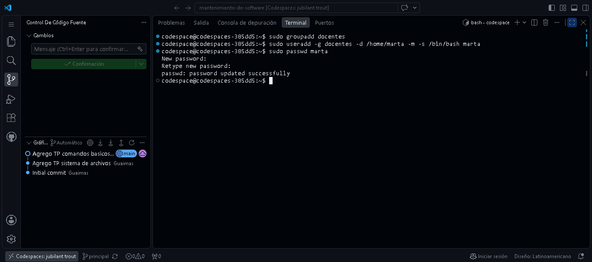
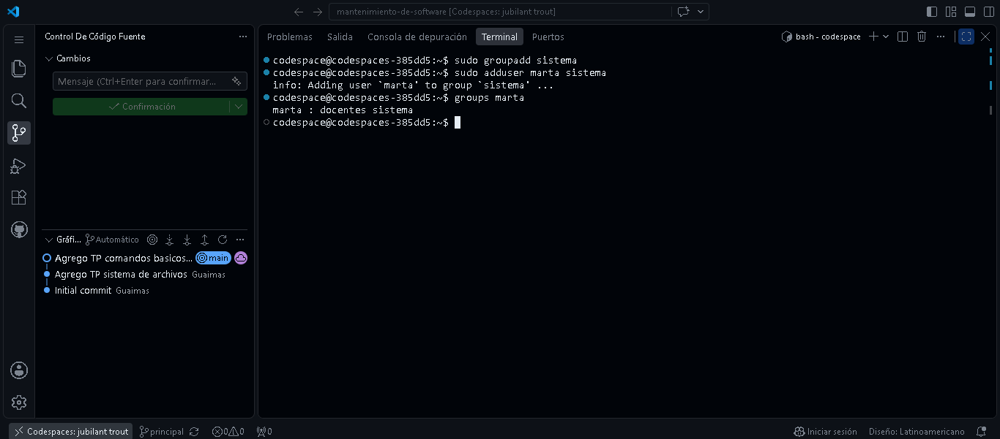
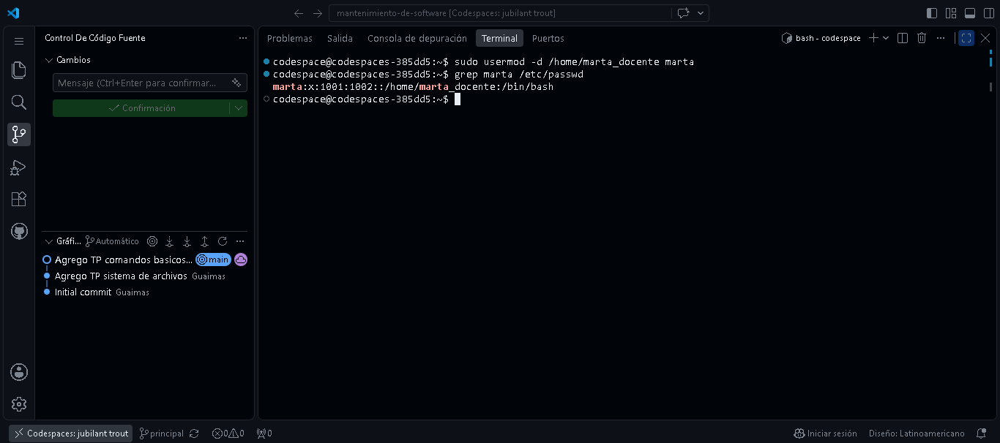
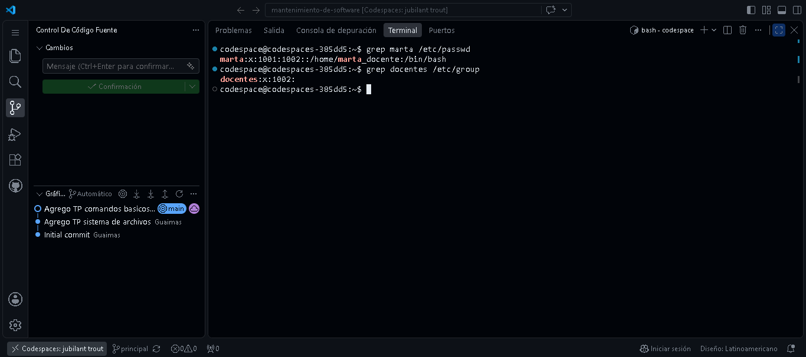
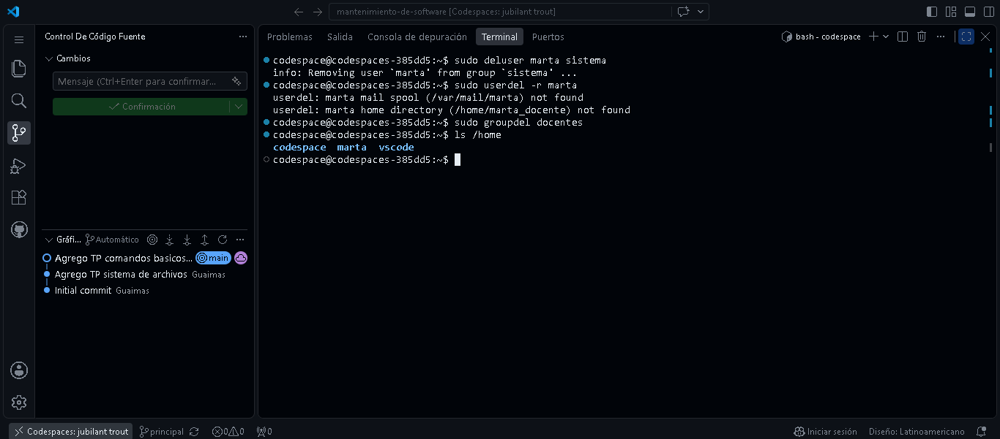

# TP: Administración de Usuarios y Grupos en Linux

* **Materia:** Mantenimiento de Software
* **Estudiante:** Samuel Francisco Guaimas
* **Curso:** 4.º 3.ª – Técnico Informático – E.E.T. N.º 3139
* **Fecha de Entrega:** Noviembre 2026
* **Profesor:** Artaza

> **Entorno utilizado:** las prácticas se realizaron en una terminal Linux (Ubuntu 22.04) de **GitHub Codespaces**, con el usuario `codespace` (con permisos de `sudo`) en el equipo `codespaces-385dd5`.

---

## 1. Creación de Grupos y Usuarios

**Comandos ejecutados:**

```bash
sudo groupadd docentes
sudo useradd -g docentes -d /home/marta -m -s /bin/bash marta
sudo passwd marta
```



En la captura se ve que se crea el grupo `docentes` y luego la usuaria `marta` con estas opciones:

* `-g docentes`: el grupo principal.
* `-d /home/marta`: el directorio personal.
* `-m`: la creación automática de la carpeta.
* `-s /bin/bash`: la shell.

Por último, con `passwd` se le asigna una contraseña, que se escribe dos veces y no se muestra en pantalla por seguridad. El sistema confirma con `password updated successfully`.

* **Explicación del parámetro `-m`:** La opción `-m` (*make home*) le indica a `useradd` que **cree físicamente el directorio personal** del usuario (en este caso `/home/marta`). Además, copia dentro de él los archivos de configuración básicos que están en `/etc/skel` (como `.bashrc` y `.profile`). Si se **omite** `-m`, el usuario se crea igual y en `/etc/passwd` queda registrada la ruta `/home/marta`, pero **la carpeta no existe en el disco**. Por eso, al iniciar sesión, el usuario no tendría un lugar donde guardar sus archivos ni su configuración, y el sistema mostraría un error del tipo *"No directory, logging in with HOME=/"*.

---

## 2. Gestión de Grupos Secundarios

**Comandos ejecutados:**

```bash
sudo groupadd sistema
sudo adduser marta sistema
groups marta
```



En la captura se ve que `adduser` confirma `Adding user 'marta' to group 'sistema'`, y que `groups marta` muestra `marta : docentes sistema`. Es decir, marta pertenece a **`docentes`** (su grupo primario) y a **`sistema`** (grupo secundario).

* **Comando para quitar usuario de un grupo:** Para quitar a un usuario de un grupo secundario se usa:

  ```bash
  sudo deluser marta sistema
  ```

  Otra forma equivalente es `sudo gpasswd -d marta sistema`. En ambos casos solo se saca al usuario del grupo: el usuario y el grupo siguen existiendo.

---

## 3. Modificación de Usuarios

**Comandos ejecutados:**

```bash
sudo usermod -d /home/marta_docente marta
grep marta /etc/passwd
```



El comando `usermod` no muestra ningún mensaje cuando funciona correctamente. Por eso se agregó `grep marta /etc/passwd`, que muestra la línea de la usuaria con el nuevo directorio personal: `/home/marta_docente`.

> **Observación:** `usermod -d` solo cambia la ruta registrada en `/etc/passwd`, pero **no mueve** la carpeta ni su contenido. Para mover también los archivos habría que agregar la opción `-m` (`sudo usermod -d /home/marta_docente -m marta`).

* **Diferencia entre `useradd` y `usermod`:** `useradd` se usa para **crear** una cuenta de usuario nueva que todavía no existe. `usermod` se usa para **modificar** una cuenta que **ya existe**, por ejemplo para cambiar su directorio personal (`-d`), su shell (`-s`), su grupo principal (`-g`) o agregarlo a grupos secundarios (`-aG`). Por eso, si se intenta usar `usermod` con un usuario que no existe, da error.

---

## 4. Ficheros de Configuración

**Comandos ejecutados:**

```bash
grep marta /etc/passwd
grep docentes /etc/group
```



La línea obtenida de `/etc/passwd` es `marta:x:1001:1002::/home/marta_docente:/bin/bash`. Sus campos están separados por `:`, en este orden:

1. `marta`: nombre de usuario.
2. `x`: indica que la contraseña está guardada en `/etc/shadow`.
3. `1001`: UID (número de identificación del usuario).
4. `1002`: GID del grupo principal (`docentes`).
5. *(vacío)*: comentario o nombre completo.
6. `/home/marta_docente`: directorio personal.
7. `/bin/bash`: shell.

La línea de `/etc/group` es `docentes:x:1002:`, que indica el nombre del grupo, la contraseña del grupo (`x`), el GID (`1002`) y la lista de miembros secundarios. La lista está vacía porque para marta `docentes` es su grupo **primario**, y eso se indica en `/etc/passwd`.

| Fichero | Contenido / Función |
| :--- | :--- |
| `/etc/passwd` | Guarda la información de las **cuentas de usuario**: nombre, UID, GID del grupo principal, comentario, directorio personal y shell. Lo pueden leer todos los usuarios, por eso no contiene las contraseñas (en su lugar aparece una `x`). |
| `/etc/group` | Guarda la información de los **grupos**: nombre del grupo, contraseña de grupo (`x`), GID y la lista de usuarios que pertenecen a ese grupo como grupo secundario. |
| `/etc/shadow` | Guarda las **contraseñas cifradas** de los usuarios y datos sobre su vencimiento (fecha del último cambio, días mínimos y máximos de validez, avisos, etc.). Solo puede leerlo el usuario `root`, por seguridad. |

---

## 5. Eliminación de Usuarios y Grupos

**Comandos ejecutados:**

```bash
sudo deluser marta sistema
sudo userdel -r marta
sudo groupdel docentes
ls /home
```



En la captura se ve que primero se quita a marta del grupo `sistema` (`Removing user 'marta' from group 'sistema'`), luego se elimina la usuaria y por último el grupo `docentes`.

**Análisis de los avisos de `userdel`:** el comando mostró dos avisos:

* `mail spool (/var/mail/marta) not found`: la usuaria no tenía buzón de correo local. No es un problema.
* `home directory (/home/marta_docente) not found`: como en el punto 3 se cambió la ruta del home con `usermod -d` **sin mover la carpeta**, `userdel -r` buscó `/home/marta_docente`, que nunca existió. Por eso, con `ls /home` se comprueba que la carpeta original **`/home/marta` quedó sin borrar**. Para limpiarla habría que ejecutar `sudo rm -r /home/marta`.

Este caso muestra por qué, al cambiar el home de un usuario, conviene usar `usermod -d nueva_ruta -m` para que la carpeta se mueva junto con la configuración.

* **Uso del parámetro `-r` en `userdel`:** La opción `-r` (*remove*) hace que, además de eliminar la cuenta del usuario de `/etc/passwd`, `/etc/shadow` y `/etc/group`, se **borren también su directorio personal (home) con todos sus archivos y su buzón de correo** (`/var/mail/usuario`). Sin `-r`, solo se elimina la cuenta y la carpeta personal queda en el disco.

* **Condición para borrar un grupo con `groupdel`:** Para poder eliminar un grupo, **no puede ser el grupo primario de ningún usuario existente**. Por eso primero se eliminó a marta (que tenía a `docentes` como grupo principal) y recién después se pudo borrar el grupo `docentes`. Si se intenta borrar antes, `groupdel` da un error indicando que no se puede eliminar el grupo primario del usuario `marta`.
